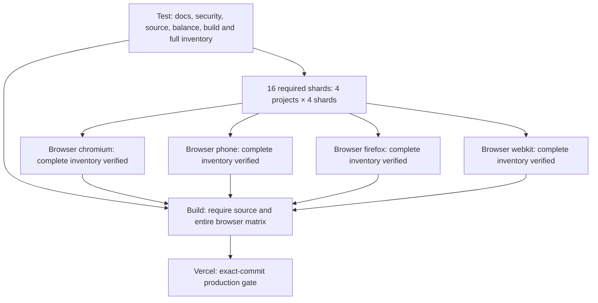

# CI and test refactor

The previous release spent 45.1 minutes in WebKit's full browser suite. Vercel's production build exceeded its maximum duration while waiting for the required checks, so publishing required another deployment of the tested commit. The same release also exposed a 30-second archive case reaching its final storage assertion at the deadline.

This change keeps the full browser coverage and release requirements while shortening the critical path. It introduces no game, story, art, voice, save or balance changes.

## Execution graph

`Test`, the four `Browser (project)` checks and `Build` retain their names. The Browser checks now validate and merge full-project shard results. They require both Test and the entire shard matrix to succeed, so no failed child can be hidden by a successful-looking aggregate. The extra shard checks provide progress and individual failure evidence.

All jobs use Ubuntu 24.04 and Node 22. Test compiles the application and audits the static production catalog once. Every shard restores that exact `.next` artifact rather than compiling another copy. The build cache is excluded from the artifact. Public score deliveries are regenerated deterministically from the same source. Browser binaries are cached against the OS, architecture, dependency lock and project, while browser/system dependency installation and the virtual audio device remain mandatory. Firefox/WebKit shards install their own engine; the only extra Chromium launcher in the tests is explicitly scoped to Chromium's native-policy coverage.

Each project's first shard retains the nine speaker-caption preflight cases. Chromium's first shard also retains the native autoplay smoke with one worker and the loading/performance probe. Every full-suite shard retains four workers, ordinary browser dependency validation, the original test deadlines and the original one retry in CI. This trades more concurrent runners for a shorter wall-clock run; available account concurrency and dependency mirrors still affect duration. Hosted timings must establish the actual improvement.

## Coverage and artifact protocol

`scripts/browser-ci.mjs` exposes `plan`, `run PROJECT SHARD`, and `verify PROJECT`. The implementation is in `scripts/browser-ci-core.mjs`; the real Playwright reporter is `qa/ci/coverage-reporter.ts`.

1. **Plan:** collect every case in all four projects, without a grep or reduced test selection. Bind the plan and compiled build to the Git SHA, dependency lock, build id, Playwright version, Node major, platform, architecture, workflow run and attempt.
2. **Run:** verify the restored identity and plan digest before launching the canonical project and shard. Emit actual test ids, outcomes, execution attempts and durations, plus a raw Playwright blob report and failure evidence. An old result is removed before execution so reporter failure cannot reuse it.
3. **Verify:** require every shard job to succeed and exactly four distinct reports for the project. Reject missing or duplicate cases, unexecuted rows, other projects, stale identities/attempts, failed/interrupted results, hidden retries and unexpected skips. The union must equal the full collected project inventory exactly once.
4. **Publish evidence:** merge all four verified blob reports into one browsable project report. A missing/corrupt report blocks the acceptance check. Report retries honestly instead of presenting flaky results as first-pass successes.

Artifact names include the workflow attempt; downloads stay within the current run. Rerun the **whole workflow**, not selected shards, so build, plan and results share one attempt. Only the two pre-existing native autoplay-policy cases may skip outside Chromium. No other new skip or expected failure is accepted. `lib/browser-ci.test.ts` covers missing, duplicate, failed, stale and unauthorized-skip evidence; `lib/browser-ci.integration.test.ts` executes the real reporter/CLI protocol across sixteen shards using assertion-only synthetic cases, including the native-skip format and a deliberately missing artifact. That protocol test does not claim game/browser coverage; the hosted shards still run every real case.

CI graph and documentation tests parse YAML using pinned development-only `yaml`, replacing fragile substring extraction. Actions stay pinned, checkout credentials are discarded, permissions remain `contents: read`, and tests receive no deployment credential. Hidden build artifacts contain no pulled Vercel environment files or authentication state.

## Focused browser suites

The old 1,878-line `tests/game.spec.ts` is now nine focused suites:

| Suite | Scope |
| --- | --- |
| `game.spec.ts` | Creation, navigation, saves, controller and basic accessibility |
| `campaign-continuity.spec.ts` | Opening context, copy outcomes and hearing continuity |
| `campaign-contracts.spec.ts` | Campaign integration, clinic terms and source boundaries |
| `archive-witness-flow.spec.ts` | Archive custody, witness permissions, worker follow-through |
| `opening-and-reading.spec.ts` | Opening choices, reading, settings and persisted presentation |
| `district-contracts.spec.ts` | Freight and shelter methods and recovery |
| `memory-and-spire.spec.ts` | Memory timeline, Spire methods and matching art |
| `audio-lifecycle.spec.ts` | Speech, score, loading, cancellation and mixer behavior |
| `character-boundaries.spec.ts` | Kerr/Mara responses, memorial scope and earned returns |

Shared canonical setup and the unchanged audio observers live in `tests/fixtures/game.ts` and `tests/fixtures/audio.ts`. The migration checked all 112 original top-level test statements: 111 retain byte-identical bodies, while the archive flow is deliberately split into two cases. All ten assertions from that flow remain, with an additional exact checkpoint equality assertion. Every other collected semantic title is preserved. Discovery changes from 1,000 to 1,001 cases per browser, or 4,000 to 4,004 executions across the four projects. See `qa/ci/test-refactor.json` for the original source hash and inventory evidence.

The archive cases are independent. The custody case drives the real UI through the original comparison, correction, invoice, reload and withholding choices, then asserts its complete saved state equals a checkpoint replayed through the same canonical engine actions. The later worker case starts from that proven checkpoint and retains the original later-visit/reload sequence, 60-credit outcome, support flag and absence of source authentication. Neither case depends on another test having run first or invents a verified source. Both keep the normal 30-second deadline.

## Validation and release

The split archive cases passed twenty repeated Chromium/WebKit executions with four workers and zero retries. The complete collected inventory comparison and the real reporter protocol test passed. Source tests, production build, dependency audit and a real full Chromium shard are checked before pushing; the final hosted run must execute all sixteen real shards and all six existing required acceptance checks. New measured durations and publication observations belong in the separate production report, not an artificial status-only commit.

`vercel.json` and the bounded 45-minute exact-commit wait remain fail-closed. Faster CI is intended to fit comfortably within that window; the refactor does not bypass checks, force promotion, extend Vercel's build deadline or add deployment credentials. If platform delays still exhaust the build, redeploy the same fully tested commit after all checks pass. Preview behavior is unchanged.

The preceding gallery production proof is preserved in `qa/editorial/artwork-gallery-release.json`. Automated/synthetic checks remain the available player-validation proxy; this infrastructure refactor is not a new AAA or 9.0 acceptance claim.
